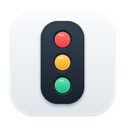

<p align="center">
  
</p>

# CodexTaskLight

**用一盏悬浮红绿灯，查看 Codex 本机任务状态。**

A small, draggable traffic light for local Codex task status on macOS.

CodexTaskLight 是一个非官方的 macOS 原生小工具。它在桌面显示一个竖款迷你悬浮窗，自动关注正在执行或等待你处理的 Codex 任务，让你不用一直切回聊天窗口。

## 状态一览

| 灯色 | 含义 |
| --- | --- |
| 🔴 红灯 | 等待确认、审批或输入；也用于表示可识别的异常状态，点击查看具体原因 |
| 🟡 黄灯 | 任务正在执行 |
| 🟢 绿灯 | 本轮任务已结束 |
| ⚪ 灰灯 | 状态未知、实时连接不可用，或尚未收到有效状态 |

绿灯表示本轮执行结束，不代表测试通过，也不代表整个项目已经完成。

## 功能

- **自动跟踪任务**：无需手动选择；有多个任务时优先显示等待你处理的任务。
- **手动指定任务**：在详情中搜索并固定跟踪一个本机任务，可随时切回自动识别；重启后保留选择。
- **实时更新**：结合桌面端状态订阅与文件事件监听，无定时日志扫描。
- **等待提醒**：识别桌面端暴露的审批/输入请求，以及有明确请求编号的异步确认问题。
- **迷你悬浮窗**：40 × 96 点，只有三盏灯；支持拖动、位置记忆和跨桌面显示。
- **操作简洁**：点击查看详情；右键查看详情、重置位置或退出。
- **本地运行**：不需要 API Key，不调用模型，不设置网络代理。

当前版本只显示悬浮窗，没有菜单栏或 Dock 图标。

## 环境要求

| 项目 | 当前范围 |
| --- | --- |
| 处理器 | Apple Silicon / `arm64` |
| macOS | 构建部署目标为 macOS 13.0；尚未逐版本验证 |
| Codex | 同一用户下已运行的 ChatGPT/Codex 桌面端，以及可读的默认 `~/.codex` 数据目录 |
| 监控范围 | 本机未归档的主任务；不包含子代理、云端执行任务或其他电脑的任务 |
| 构建工具 | Xcode Command Line Tools 或 Xcode；重新生成图标时还需要 Python 3 |

**兼容性说明：**项目使用桌面端内部 IPC 协议和本地数据格式，并非官方稳定 API。当前实现按状态协议 v11 适配，桌面端更新后可能需要调整。仅安装 Codex CLI 不等于具备所需的桌面端状态通道。

## 从源码构建

```bash
git clone https://github.com/lucifly/CodexTaskLight.git
cd CodexTaskLight
./build.command
```

也可以在访达中双击 `build.command`。编译结果位于：

```text
dist/CodexTaskLight.app
```

双击应用启动，或运行：

```bash
open dist/CodexTaskLight.app
```

当前以源码构建为主，本文不假定已经发布可下载的 Release。`dist/` 是本地构建产物，已从 Git 提交范围排除。

应用使用本地临时签名（ad hoc），未配置 Developer ID 签名或 Apple 公证。面向他人分发前，应另外完成发布和签名验证。

## 日常使用

1. 打开 Codex 桌面端，再启动 CodexTaskLight。
2. 悬浮窗默认显示在屏幕右上方；拖动可调整位置。
3. 自动模式优先关注等待你处理或正在执行的任务；也可点击灯，在“手动指定”中搜索并选择任务。
4. 所选任务等待处理时亮红灯；处理后依据后续状态恢复黄灯或进入结束状态。右键可重置位置或退出。

如果悬浮窗看不到，再次双击应用可尝试重新显示。

详细操作和常见问题见[使用说明](docs/USAGE.md)。

## 工作方式与隐私

桌面端实时状态流负责提供任务状态，文件事件监听负责发现新任务和解析明确的异步确认请求。日志增量读取、事件合并以及固定图层绘制用于减少重复工作。

程序会在本机读取任务标题、状态以及识别所需的日志片段；实时快照也可能包含任务上下文。解析后仅保留识别所需字段，不把聊天内容另存为日志，不上传这些数据，也不读取 Codex 登录凭据。

更多细节见[实现机制](docs/ARCHITECTURE.md)和[隐私说明](docs/PRIVACY.md)。

## 开发与反馈

- [构建与检查](docs/BUILD.md)
- [贡献指南](CONTRIBUTING.md)
- [变更记录](CHANGELOG.md)
- [提交问题或建议](https://github.com/lucifly/CodexTaskLight/issues)

## 许可证

[MIT License](LICENSE)。本项目与 OpenAI 无隶属关系，不代表官方支持或兼容性承诺。
