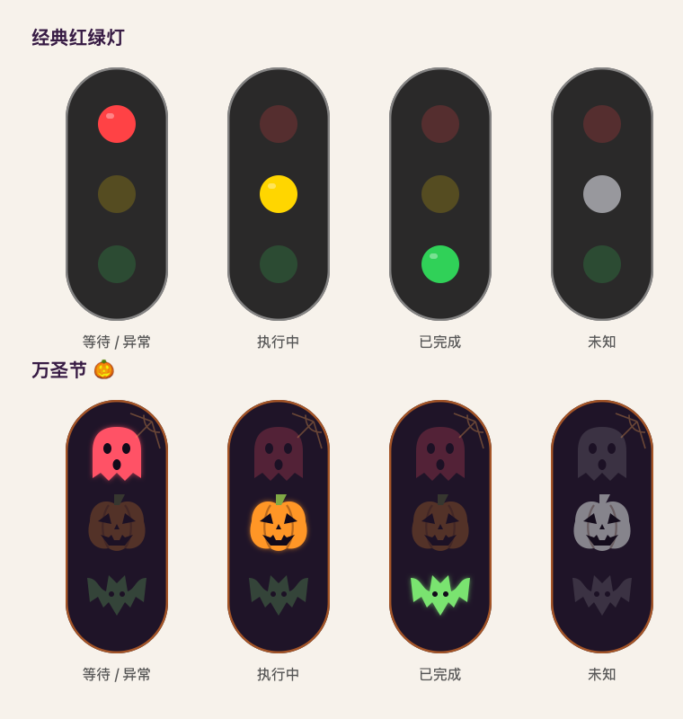

<p align="center">
  
</p>

<h1 align="center">CodexTaskLight</h1>

<p align="center"><strong>用一盏悬浮红绿灯，查看 Codex 本机任务状态。</strong></p>
<p align="center">A small, draggable traffic light for local Codex task status on macOS.</p>

<p align="center">
  <a href="#环境要求"></a>
  <a href="#环境要求"></a>
  <a href="LICENSE"></a>
</p>

<p align="center">
  <a href="https://github.com/lucifly/CodexTaskLight/releases/latest">下载应用</a> ·
  <a href="#效果预览">效果预览</a> ·
  <a href="#快速开始">快速开始</a> ·
  <a href="docs/USAGE.md">使用说明</a> ·
  <a href="CHANGELOG.md">更新记录</a> ·
  <a href="https://github.com/lucifly/CodexTaskLight/issues">反馈问题</a>
</p>

CodexTaskLight 是一个非官方的 macOS 原生小工具。它在桌面显示一个 **40 × 96 点**的竖款迷你悬浮窗，自动关注正在执行或等待你处理的任务，也支持手动固定一个任务，让你不用一直切回聊天窗口。

## 效果预览

<p align="center">
  
</p>

上排为经典红绿灯，下排为万圣节皮肤。图片由应用绘制代码导出，用于放大展示各状态，并非桌面截图；实际悬浮窗仍为 **40 × 96 点**。

在详情面板的「悬浮窗外观」或右键菜单的「外观」中切换皮肤，选择会自动保存。幽灵、南瓜和蝙蝠使用静态矢量图案，没有循环闪烁动画。

## 快速开始

当前版本为 **2.6**。可直接下载编译好的应用，无需安装开发工具，也可以从源码构建。

### 下载应用

**[下载 CodexTaskLight v2.6 · macOS Apple Silicon](https://github.com/lucifly/CodexTaskLight/releases/download/v2.6/CodexTaskLight-v2.6-macOS-arm64.zip)**

1. 下载并解压 ZIP，将 `CodexTaskLight.app` 拖入「应用程序」文件夹。
2. 打开 Codex 桌面端，再双击 CodexTaskLight。当前只有悬浮窗，没有菜单栏或 Dock 图标。
3. 升级前先右键退出旧版，再替换应用。

发布包使用 **ad hoc 本地签名，未经过 Developer ID 签名或 Apple 公证**，macOS 可能阻止首次打开。确认来源和文件校验值后，可按 [Apple 官方说明](https://support.apple.com/zh-cn/102445)为该应用单独允许打开。

[发布说明](https://github.com/lucifly/CodexTaskLight/releases/tag/v2.6)中提供系统要求与验证结果；[SHA-256 校验文件](https://github.com/lucifly/CodexTaskLight/releases/download/v2.6/SHA256SUMS.txt)用于核对下载完整性。GitHub 自动生成的 `Source code` 附件是源码，不是应用安装包。

### 环境要求

| 项目 | 要求与范围 |
| :--- | :--- |
| Mac | Apple Silicon / `arm64`；当前构建不包含 Intel 或 Universal 版本 |
| macOS | 部署目标为 macOS 13.0，尚未逐版本验证 |
| Codex | 同一用户下已运行的 ChatGPT/Codex 桌面端，以及可读的默认 `~/.codex` 数据目录 |
| 构建工具 | 仅源码构建需要 Xcode Command Line Tools 或 Xcode；重新生成图标时还需要 Python 3 |
| 监控范围 | 本机未归档的主任务；不包含子代理、云端执行或其他电脑的任务 |

**兼容性说明：** 项目依赖桌面端内部 IPC 协议和本地数据格式，并非官方稳定 API。当前实现按状态协议 v11 适配，桌面端更新后可能需要调整。仅安装 Codex CLI 不等于具备所需的桌面端状态通道。

### 构建并打开

```bash
git clone https://github.com/lucifly/CodexTaskLight.git
cd CodexTaskLight
./build.command
open dist/CodexTaskLight.app
```

也可以在访达中双击 `build.command`，构建完成后双击 `dist/CodexTaskLight.app`。先打开 Codex 桌面端，再启动本工具。

源码构建同样使用 ad hoc 签名。`dist/` 是本地构建产物，已从 Git 提交范围排除；打包应用通过 GitHub Release 附件提供。

<details>
<summary><strong>开发工具安装与本地升级</strong></summary>

如未安装 Apple 开发工具，运行以下命令并完成系统安装流程：

```bash
xcode-select --install
```

升级时先右键退出应用，再更新源码、运行 `./build.command` 并重新打开。应用标识保持不变时，已保存的偏好会继续使用。完整步骤见[构建与检查](docs/BUILD.md)。

</details>

## 功能与状态

| 功能 | 使用方式 |
| :--- | :--- |
| 自动跟踪 | 优先显示等待你处理的任务，其次是正在执行的任务 |
| 手动指定 | 在详情中搜索并固定一个本机任务，可随时切回自动识别；重启后保留选择 |
| 任务名称同步 | 优先显示在 Codex 中改过的名称，索引变化后更新详情和搜索结果 |
| 实时更新 | 结合桌面端状态订阅与文件事件监听，无定时日志扫描 |
| 等待提醒 | 识别桌面端暴露的审批、输入请求，以及有明确请求编号的异步确认问题 |
| 迷你悬浮窗 | 支持拖动、位置记忆和跨桌面显示；当前没有菜单栏或 Dock 图标 |
| 两种外观 | 经典红绿灯与万圣节皮肤，均使用相同灯位和状态规则 |
| 本地运行 | 不需要 API Key，不调用模型，不设置网络代理 |

### 灯色代表什么

| 灯色 | 含义 |
| :--- | :--- |
| 🔴 红灯 | 等待确认、审批或输入；也表示可识别的异常状态，点击查看具体原因 |
| 🟡 黄灯 | 任务正在执行 |
| 🟢 绿灯 | 本轮任务已结束 |
| ⚪ 灰灯 | 状态未知、实时连接不可用，或尚未收到有效状态 |

**绿灯表示本轮执行结束，不代表测试通过，也不代表整个项目已经完成。** 普通聊天中的提问不会仅凭「请确认」就亮红灯；识别范围见[等待确认说明](docs/USAGE.md#等待确认的识别范围)。

## 日常使用

| 操作 | 结果 |
| :--- | :--- |
| 拖动悬浮窗 | 调整位置，松开后保存；默认位于屏幕右上方 |
| 点击悬浮窗 | 查看任务详情、切换跟踪方式或选择皮肤 |
| 右键悬浮窗 | 查看详情、切换外观、重置位置或退出 |
| 再次打开应用 | 悬浮窗看不到时，可尝试重新显示 |

自动模式优先关注等待处理或正在执行的任务。需要固定目标时，点击灯，在「手动指定」中搜索并选择任务。所选任务等待处理时亮红灯，处理后依据后续状态恢复黄灯或进入结束状态。

更多操作、手动目标不可用和持续灰灯等问题，见[使用说明与常见问题](docs/USAGE.md)。

## 工作方式与隐私

桌面端实时状态流提供任务状态，文件事件监听发现新任务并解析明确的异步确认请求。日志增量读取、事件合并和固定图层绘制用于减少重复工作。

程序会在本机读取任务标题、状态及识别所需的日志片段；实时快照也可能包含任务上下文。解析后仅保留识别所需字段，不把聊天内容另存为日志，不上传这些数据，也不读取 Codex 登录凭据。悬浮窗位置、皮肤和跟踪选择保存在本机偏好中。

详见[实现机制](docs/ARCHITECTURE.md)与[隐私说明](docs/PRIVACY.md)。

## 开发与反馈

| 文档 | 内容 |
| :--- | :--- |
| [构建与检查](docs/BUILD.md) | 编译、代码风格、状态测试、文件事件与资源检查 |
| [贡献指南](CONTRIBUTING.md) | 修改代码和提交贡献的约定 |
| [变更记录](CHANGELOG.md) | 功能改动与修复记录 |
| [问题与建议](https://github.com/lucifly/CodexTaskLight/issues) | 反馈使用问题或提出功能建议 |

反馈时请提供版本、复现步骤和必要的脱敏截图，不要提交完整的 `~/.codex`、真实聊天日志或访问令牌。

## 许可证

[MIT License](LICENSE) · 本项目与 OpenAI 无隶属关系，不代表官方支持或兼容性承诺。
